# Diagrams

These diagrams follow the current routes and services. Unimplemented mail, SMS, TURN, and Redis boxes are omitted. TURN is a deployment option in `.env.example`, not a running service in this audit.

## 1. System architecture

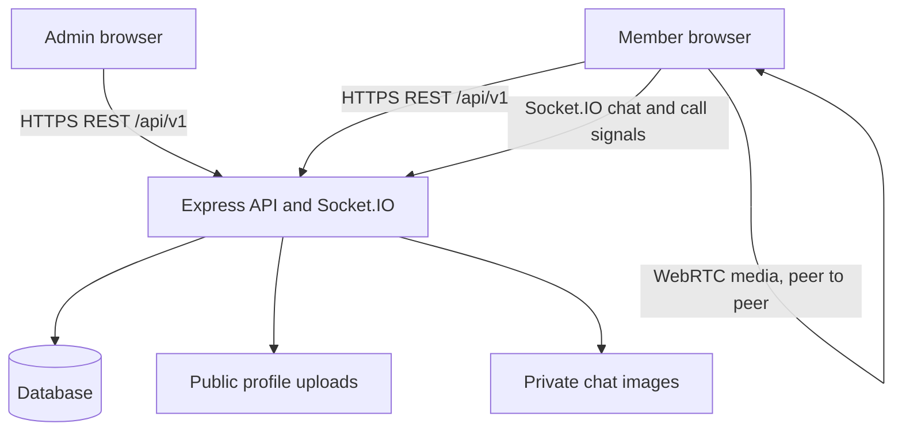

Local development uses HTTP on ports 5173 and 5000. The diagram shows the intended production boundary.

## 2. Registration and authentication

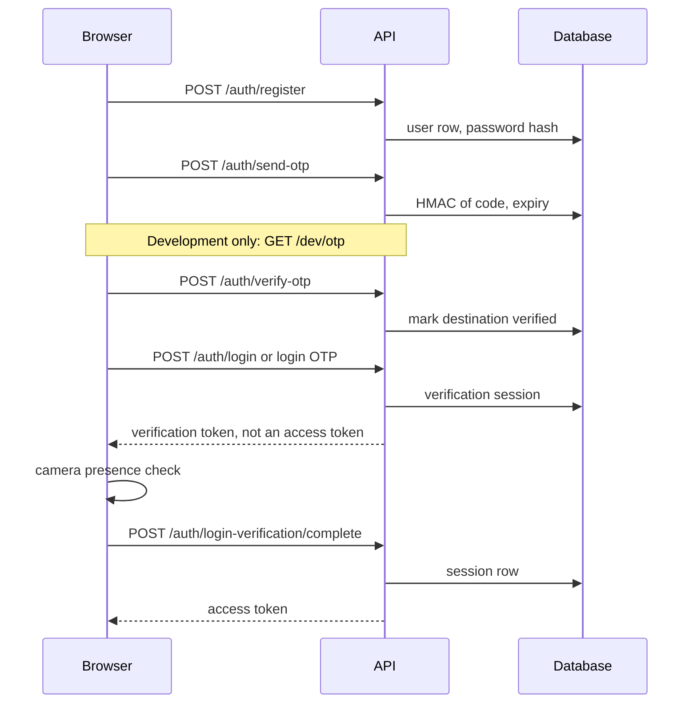

## 3. Login camera verification

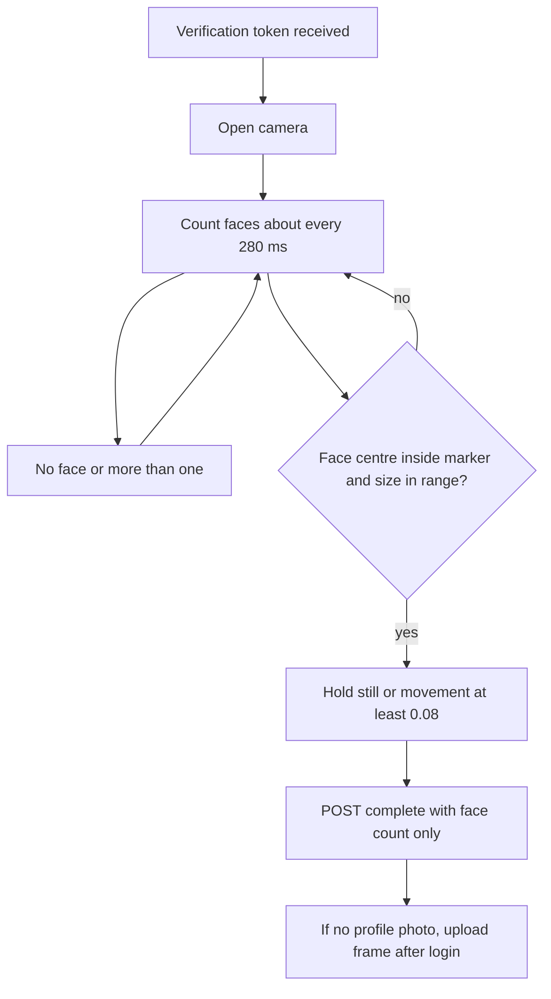

Phase 19: the server decides from the face count and the single-use verification token. A `profile_matched` value is stored only as "a client sent a boolean" and does not change the outcome. The image is not uploaded. The diagram that compared the live frame with the profile picture described the earlier client-trusted check. That check is no longer the login decision.

## 4. Profile and preferences

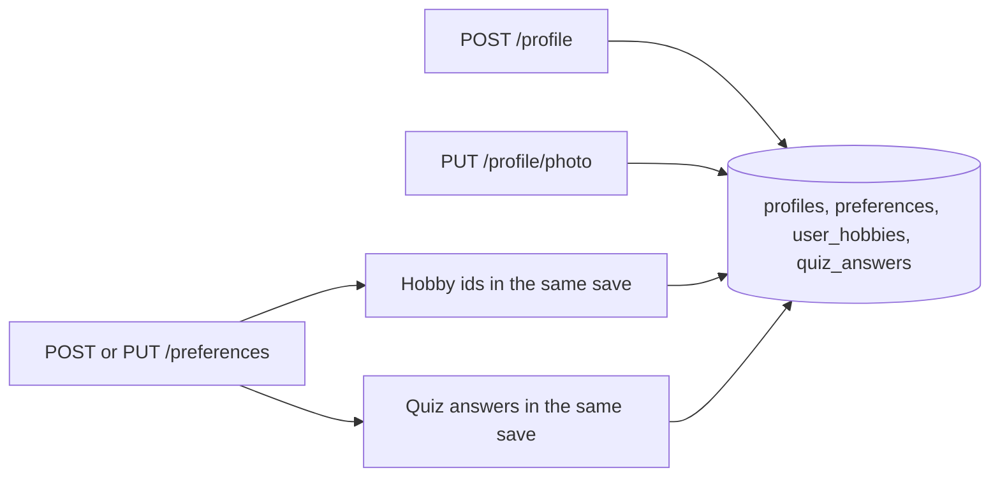

The preferences page sends preferences, hobbies, and quiz answers together. The service writes them in one transaction.

## 5. Compatibility scoring and ranking

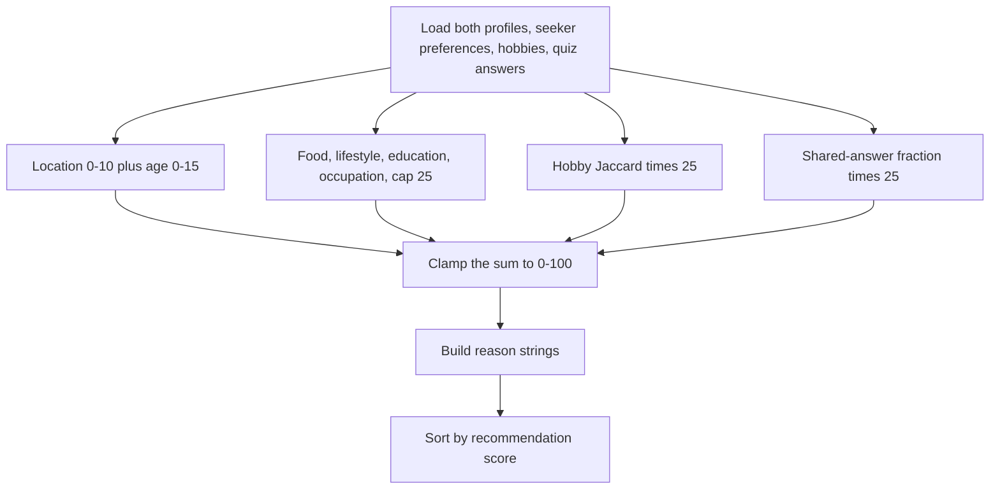

## 6. Adaptive recommendation

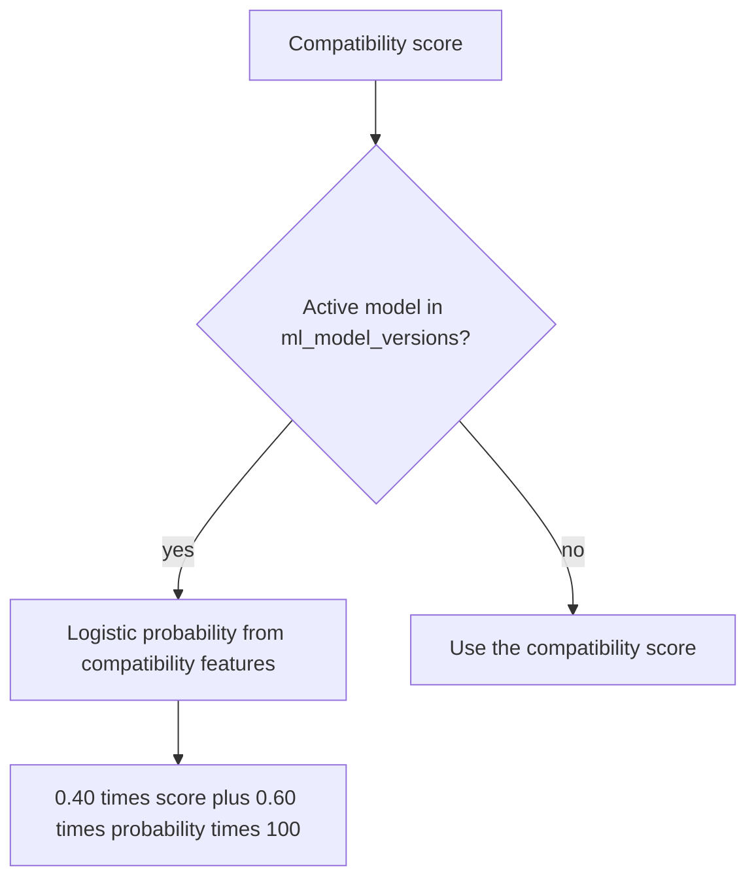

Training is a separate admin action. It reads `activity_feedback` and writes a model version. It does not run on every recommendation request.

## 7. Connection request

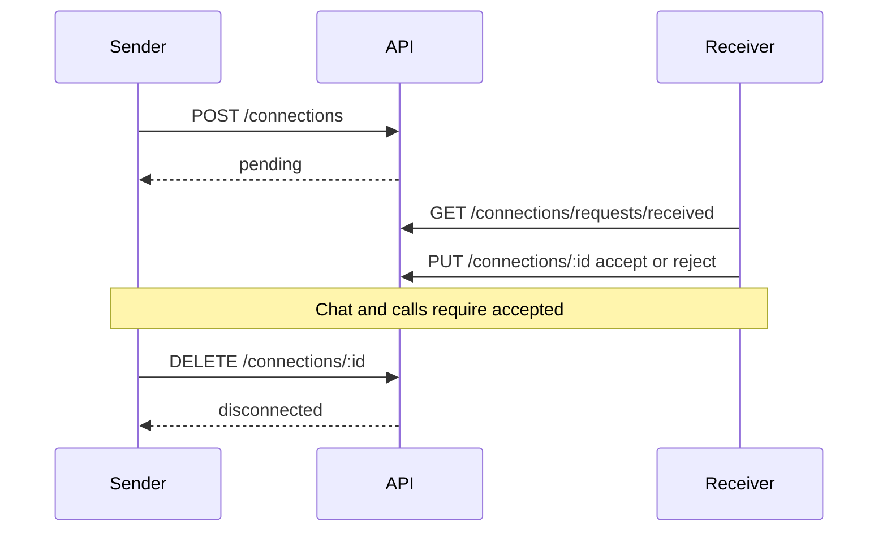

A block moves an accepted connection to disconnected and a pending request to cancelled.

## 8. Private messaging

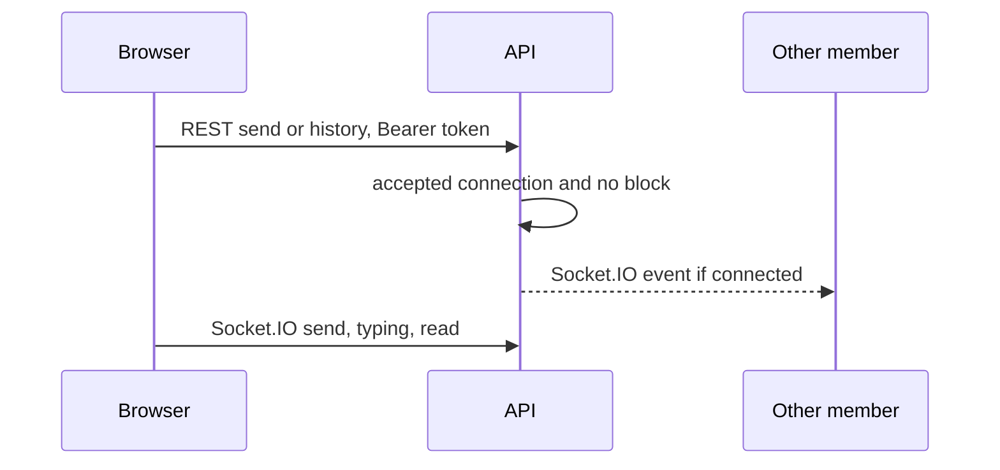

Image bytes are stored in the private upload directory. History is cursor-paginated.

## 9. WebRTC signalling

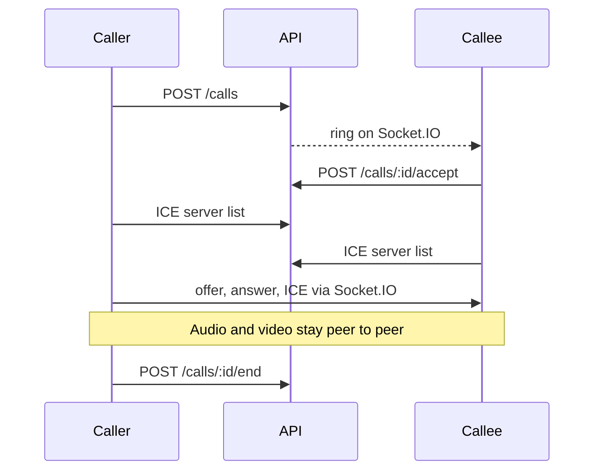

Without a TURN URL, ICE uses the configured STUN server only.

## 10. Blocking and reporting

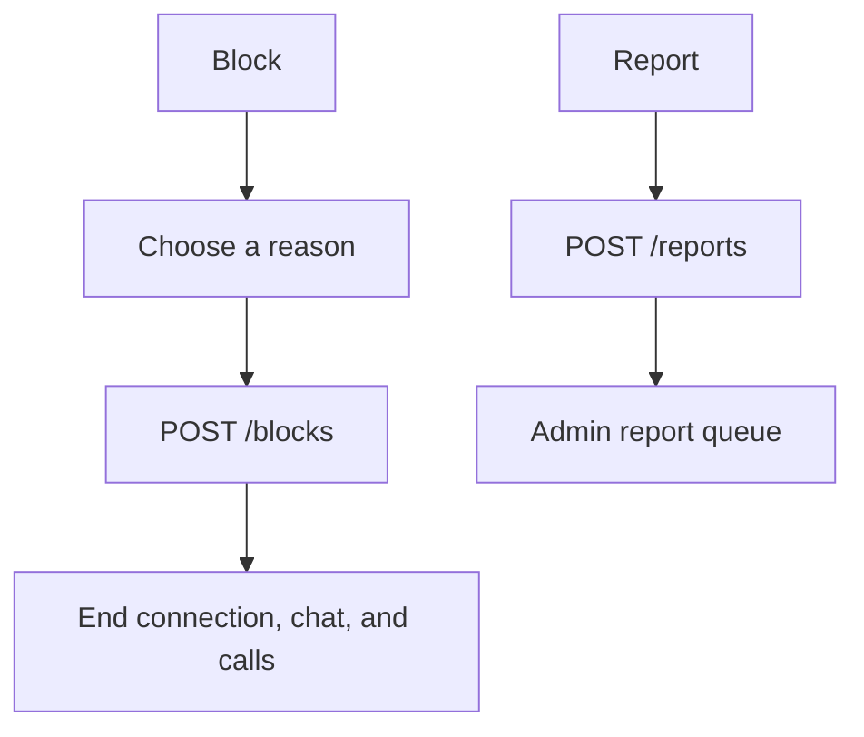

The reason codes are harassment, spam, fake_profile, inappropriate_content, threatening, and other. The API accepts a missing reason so older clients still work. The current UI always sends one.

## 11. Admin moderation

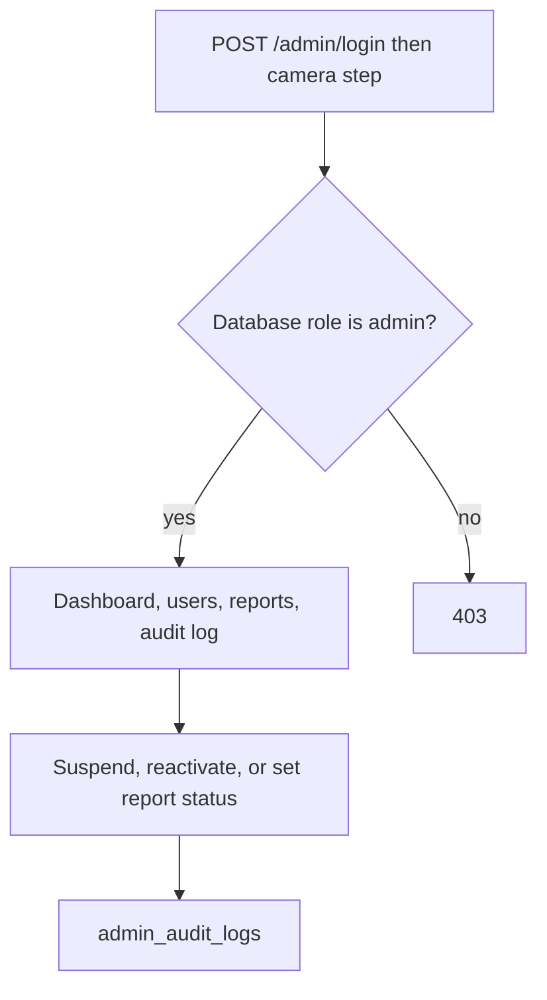

## 12. Entity relationship

```mermaid
erDiagram
  users ||--o| profiles : has
  users ||--o| preferences : has
  users ||--o| privacy_settings : has
  users ||--o{ user_hobbies : selects
  hobbies ||--o{ user_hobbies : listed
  users ||--o{ quiz_answers : answers
  users ||--o{ matches : views
  users ||--o{ connection_requests : sends
  users ||--o{ messages : sends
  users ||--o{ reports : files
  users ||--o{ blocks : blocks
  users ||--o{ activity_feedback : records
  users ||--o{ login_verifications : verifies
  users ||--o{ otp_codes : receives
  users ||--o{ user_sessions : opens
  users ||--o{ video_calls : joins
  users ||--o{ admin_audit_logs : performs
  ml_model_versions ||--o{ activity_feedback : trained_from
```

`ml_model_versions` does not have a foreign key to individual feedback rows. The last relationship means training reads that table. It is not a database constraint.

---

## 13. Phase 19 Secure profile photo access control

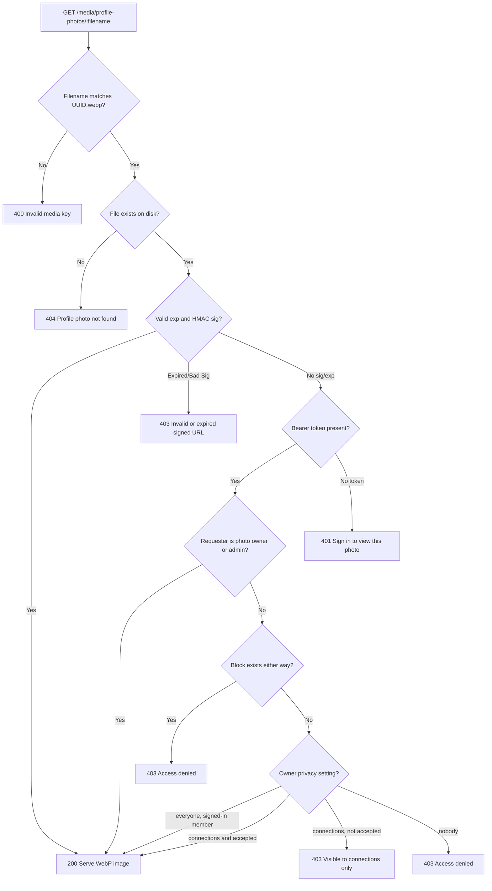

A valid signature is a short-lived capability (10 minutes by default) minted after an API response has already applied privacy. It is not a permanent public URL. "everyone" means any signed-in member, which matches the settings label "All members". There is no separate `members` level. Anonymous access without a signature is refused.

## 14. Phase 19 Multi-channel OTP delivery architecture

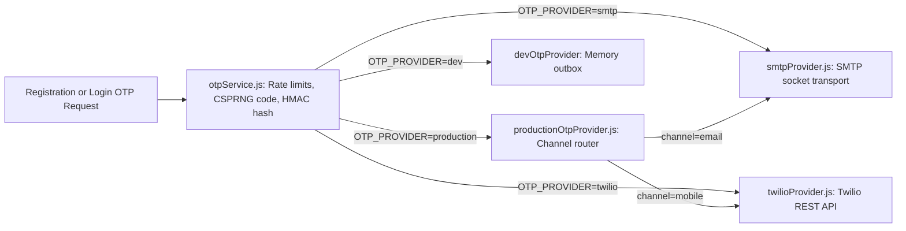

`OTP_PROVIDER=dev` is refused when `NODE_ENV=production`. The SMTP and Twilio adapters were not exercised against a live provider.

## 15. Phase 19 WebRTC TURN Relay & Ephemeral Credential Flow

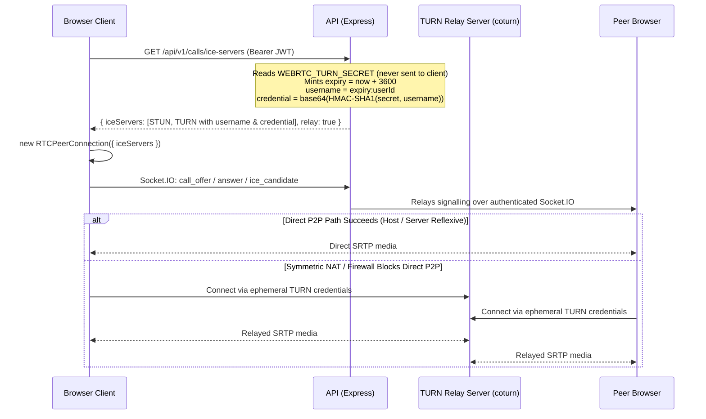

This path runs only when `WEBRTC_TURN_URL` and a secret or static credential are set. In the audited development environment the response is STUN only and `relay` is false. No coturn process was running.

