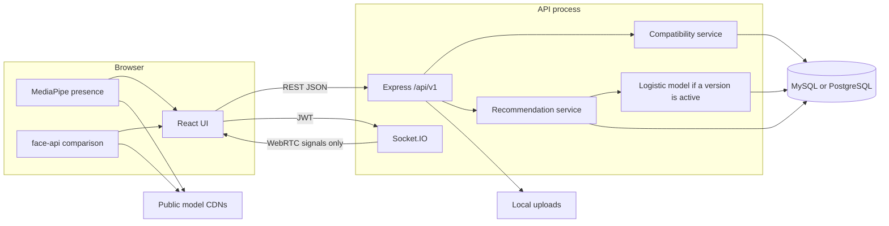

# Final project report

Secure Social Networking and Digital Matchmaking Platform. Phase 18 audit, 24 October 2026.

This report describes the implementation in the repository. A file or route existing is not treated as proof that a workflow was exercised in a browser during this audit. Automated results cited here were produced on this date unless a row says otherwise.

## 1. Final project audit

### Feature matrix

| Area | Status | What the code and this audit support |
| --- | --- | --- |
| Public landing page, member navigation, light and dark themes | COMPLETE | Implemented in the React app. Theme preference is stored in the browser. A full six-viewport and light-theme pass was not repeated in this audit. |
| Animated 3D landing hero | COMPLETE | Three.js scene in the landing hero. The production build emits a large hero chunk (about 549 kB minified). |
| Registration | COMPLETE | `POST /api/v1/auth/register`. Covered by backend unit tests. |
| OTP verification | PARTIALLY COMPLETE | HMAC-stored codes, expiry, attempt limits, and resend limits exist. Delivery is the development outbox (`OTP_PROVIDER=dev`). A production email or SMS provider is not configured. The development route is refused when `NODE_ENV=production`. |
| Password login | COMPLETE | scrypt hashes. Failed-attempt and IP rate limits exist. |
| Live human presence at login | COMPLETE | MediaPipe BlazeFace in the browser. One face must sit in the on-screen marker; the frame is captured automatically. Backend unit and frontend tests cover the rules. A physical camera was not rechecked in this audit. |
| Profile-picture comparison at login | PARTIALLY COMPLETE | When a profile photo URL exists, the browser compares it with the live frame and sends `profile_matched`. The server refuses login if that flag is not true. The server does not see the image or a face descriptor, so a modified client can send `true`. Accounts with no photo skip this check. |
| Profile create, edit, and photo upload | COMPLETE | Profile routes and the profile UI tests passed after a broken profile form was repaired in this audit. Photos are re-encoded with sharp and served from local `/media`. |
| Login frame saved as the first profile picture | COMPLETE | If there is no profile photo, the captured JPEG is uploaded after the token is issued, or held in memory until the first profile save. Existing photos are not replaced. |
| Preferences, hobbies, quiz | COMPLETE | Saved in one transaction. Frontend preference tests passed. Quiz content is the bundled sample questionnaire. |
| Compatibility score and ranking | COMPLETE | Deterministic scorer in `matchingService.js`. Backend unit tests include the matching service. The formula is the sum of component points, not a renormalised weighted average. |
| Adaptive recommendation | PARTIALLY COMPLETE | Logistic regression can be trained from `activity_feedback` and blended with the compatibility score when an active model row exists. With no active model the rank is the compatibility score. This audit did not train a model and did not measure Precision@K or acceptance rate. |
| Connection requests | COMPLETE | Send, accept, reject, cancel, list, and remove. Frontend connection tests passed. Chat and video require an accepted connection. |
| Private messaging | COMPLETE | REST plus Socket.IO for accepted connections, including private image storage. Live two-browser messaging was not repeated in this audit. Backend messaging unit tests are inside the passing unit suite. |
| WebRTC video calling | PARTIALLY COMPLETE | Signalling, call records, and an ICE-server endpoint exist. The example TURN settings are empty, so calls can fail off a simple local network. A live call was not placed in this audit. |
| Privacy settings | COMPLETE | Per-field visibility, enforced when profile data is returned. The settings form now binds each select to the saved value. Frontend privacy tests passed. |
| Blocking and reporting | COMPLETE | Block requires a reason in the UI and stores it. Report categories, rate limits, and admin review exist. Frontend privacy tests cover the block dialog. |
| Admin dashboard and moderation | COMPLETE | Users, reports, status changes, audit log, and ML monitoring. Frontend admin tests passed after a broken monitoring page was repaired. Promoting an admin is a server script, not a public sign-up. |
| Responsive layout | NOT VERIFIED | Styles include member and admin breakpoints. This audit did not walk desktop and mobile viewports in a browser. |
| Automated unit tests | COMPLETE | See the test report. Backend 322 passed. Frontend 216 passed. |
| Database integration suite (`npm run test:db`) | NOT RUN | Not executed in this audit. It rebuilds a separate test database. |
| Production deployment | NOT IMPLEMENTED | No hosting provider is configured in the repository. This audit did not deploy. |
| Security certification or penetration test | NOT IMPLEMENTED | No certificate or test report exists in the repository. |

### Architecture actually present

- Frontend: React 19, React Router 7, Vite 8. API access goes through `frontend/src/services`.
- Backend: Node.js, Express 5, Zod validation, Knex. Business rules live in services. Models talk to the database.
- Database: Knex migrations support PostgreSQL and MySQL/MariaDB. The development database inspected here uses MySQL (`DB_CLIENT=mysql`). All 27 migration files are applied. None are pending.
- Files: profile photos on local disk, public URL under `/media`. Chat images under a private uploads directory.
- Real time: Socket.IO on the API process. Redis is optional and unset, so one API process is the supported setup.
- External calls from the browser: MediaPipe and face-api model files from public CDNs unless the optional MediaPipe URLs in `frontend/.env.example` are overridden.

### Authentication and security (verified in source, not by a penetration test)

Passwords use scrypt. OTP values are stored as HMAC, with expiry and attempt limits. Access tokens are JWTs checked against `user_sessions`, so logout can revoke a session. Admin routes re-read the role from the database. Helmet, CORS allow-list, request validation, and rate limits are present. Profile uploads are size-limited and re-encoded. The development OTP endpoint is not mounted in production.

### Testing coverage

Backend unit tests do not need a database and passed. Frontend component tests passed. Schema integration tests, the Postman collection, the video end-to-end script, and a manual browser demonstration were not run in this audit.

### Deployment status

Not deployed. `GET /api/v1/health` on the local development API returned success in the `development` environment while this report was written.

## Chapter 1 — Introduction

People use social networks to stay in touch and matchmaking services to meet someone compatible. Those products often ask for a detailed profile, then leave the person unsure why a particular profile was suggested, how much of that profile strangers can see, and whether the account on the other side of a chat is a person at the keyboard.

This project is a course-scale platform that combines member profiles, a transparent compatibility score, connection requests, private chat, and video calling, with an administrator who can review reports. It is aimed at people who want a smaller, explainable alternative to a commercial dating app, and at an operator who needs basic moderation tools.

The objectives implemented in this repository are:

- Let a person register, confirm a one-time code in development, and sign in only after a live camera check.
- Store a profile, preferences, hobbies, and quiz answers.
- Rank other members with an explainable score.
- Optionally adjust that rank with a model trained on later interaction events, when such a model has been trained.
- Allow a private connection, then chat and a video call, and let either person block or report the other.
- Give an administrator a dashboard, user status controls, and a report queue.

The scope is a single web application and API. It does not include a native mobile app, payments, or a claim that the scoring is more accurate than published matching systems. Intended users are adult members and a small number of promoted administrators.

Expected benefits, limited to what the software actually does, are a visible reason for each score, server-side visibility controls, and a recorded path from report to moderation. The project does not remove harassment, catfishing, or bad matches by itself.

## Chapter 2 — Literature and existing-system review

Existing products fall into a few groups. Profile directories let people search attributes they typed in. Preference-based matchmaking adds the seeker's stated age, location, and lifestyle filters. Recommender systems go further and reorder candidates from behaviour, not only from the form. Real-time social products add chat and calls after a relationship exists. Each group has a privacy cost: more behavioural data can improve ranking and can also reveal more than the person meant to share.

Published work that this chapter relies on, as distinct from this project's own choices:

- Boyd and Ellison describe social network sites as profile-centred services where people articulate a list of others with whom they share a connection (Journal of Computer-Mediated Communication, 2007).
- Finkel, Eastwick, Karney, Reis, and Sprecher review online dating and argue that matching algorithms are often opaque and that their superiority to simpler meeting is not well established (Psychological Science in the Public Interest, 2012).
- Resnick and Varian frame recommender systems as tools that help people choose from a large set using the opinions or behaviour of others (Communications of the ACM, 1997).
- Koren, Bell, and Volinsky describe matrix-factorization recommenders used at large scale (IEEE Computer, 2009). This project does not implement matrix factorization.
- The W3C WebRTC specification defines peer-to-peer media negotiated in the browser. This project uses that model for calls and does not record the media on the server.

This review did not include a new systematic literature search. It does not claim that no similar system has been published. Design choices below are this project's, not findings copied from those papers.

This project uses profile fields and stated preferences for a deterministic score, then an optional logistic model on a small feature vector derived from that score. It does not use collaborative filtering. Privacy is a set of visibility levels enforced when the API builds a profile response. Real-time chat and calls are available only after both people have an accepted connection and neither has blocked the other.

## Chapter 3 — Proposed system

A member registers with email or mobile and a password, confirms a one-time code, and later signs in with a password or a code. Credentials do not return an access token. They return a short-lived verification token. The browser opens the camera, looks for exactly one face inside the marker, and captures a frame automatically once the face stays centred or moves enough to count as live. The image used for that presence decision is not uploaded as part of the verification request.

If the account already has a profile picture, the browser loads face-api models and compares the live frame with that picture. A mismatch shows "Your face does not match your profile picture. Login was not completed." and does not call the completion API. A match sends `profile_matched: true`. The server applies the same rule from the stored photo URL and that boolean. This is a client-side similarity check plus a server-side flag. It is not a government identity check, and it is not a comparison performed on the server.

If the account has no profile picture, presence is enough. After the access token is issued, the captured frame is uploaded as the profile picture when a profile row already exists. Otherwise it is kept in memory and uploaded when the person first saves a profile. A later "Change photo" action is a normal file upload and does not rerun login verification.

After sign-in the member completes a profile, sets preferences and hobbies, and may answer the sample quiz. Recommendations list other members with a score and short reasons. Either person can send a connection request. The receiver accepts or rejects. Accepted pairs can exchange text and images and can start a video call. Privacy settings choose who sees each profile field. Block asks for a reason, then ends the connection and closes chat and calls. Report files a category for an administrator.

Administrators sign in through `/admin/login`, pass the same camera step, and then open the dashboard, user records, and reports. Ordinary members receive 403 on admin routes.

## Chapter 4 — System architecture

The browser never opens the database. Media for a call moves between the two browsers. The API relays signalling and stores call metadata. Profile photos are read back from the API origin. Chat images are not on the public media path.

Services that are not in this process: a production email or SMS gateway, a TURN server (unless configured), Redis, and object storage other than the local disk.

## Chapter 5 — Database design

Migrations in `backend/src/db/migrations` are the source of truth. `backend/docs/database-schema.md` documents the earlier tables in detail. Later migrations add video calls, privacy settings, report fields, admin audit logs, and `blocks.reason`. Column types below are the logical types. PostgreSQL uses `timestamptz` and `jsonb`. MySQL uses `DATETIME` in UTC and `JSON`.

| Table | Purpose | Keys and notable constraints |
| --- | --- | --- |
| `users` | Account, role, status, password hash, verification timestamps | `user_id` PK. Email and mobile unique when present. |
| `profiles` | Public-facing profile and photo URL | `user_id` PK and FK to users. |
| `preferences` | What the member is looking for, including partner age and a JSON gender preference | `user_id` PK and FK. |
| `hobbies` | Catalogue | `hobby_id` PK. Unique name. |
| `user_hobbies` | Selected hobbies | Composite PK (`user_id`, `hobby_id`). |
| `quiz_answers` | Questionnaire answers | `id` PK. FK to users. |
| `matches` | Stored score and breakdown for a pair | `match_id` PK. FKs to both users. |
| `connection_requests` | Request lifecycle, including accepted and disconnected | `id` PK. Sender and receiver FKs. |
| `messages` | Private messages, including image metadata | `id` PK. Sender and receiver FKs. |
| `reports` | Member reports and moderation status | `id` PK. Reporter, reported user, optional reviewer. |
| `blocks` | Block pair and optional reason code | Blocker and blocked user FKs. `reason` nullable, length 40. |
| `activity_feedback` | Interaction labels for training | Actor FK. Optional target user. |
| `login_verifications` | Verification session and outcome | FK to users. |
| `otp_codes` | HMAC of a code, expiry, attempts | FK to users. |
| `user_sessions` | Revocable sessions | FK to users. Optional link to the verification that created it. |
| `ml_model_versions` | Weights, sample counts, metrics, active flag | Version identity in the table. |
| `video_calls` | Call metadata, not media | Participants and status. |
| `privacy_settings` | Visibility level per field | FK to users. |
| `admin_audit_logs` | Moderation and training actions | Admin FK. |

No production credentials or member rows are copied into this report. The entity diagram is in [diagrams.md](diagrams.md).

## Chapter 6 — Compatibility algorithm

The implemented score is the sum of four parts, then clamped to 0–100. It is not `100 × weighted similarity / applicable weight`. Missing data often receives a midpoint instead of being dropped from the denominator.

| Part | Range | Rule |
| --- | --- | --- |
| Location | 0–10 | 10 same city, 8 same state, 5 same country, otherwise 2. Preferred location adds 2, still capped at 10. If either profile is missing, location is 5. |
| Age | 0–15 | 15 when the candidate's age is inside the seeker's minimum and maximum, or when age is unknown. Each year outside the range subtracts 3, down to 0. Default range is 18–100. |
| Food, lifestyle, education, occupation | up to 25 | Each starts at 5. Exact food or lifestyle match, or an education or occupation substring match, raises that item to 7 or 6. The four items are capped at 25. |
| Hobbies | 0–25 | Jaccard index of hobby ids times 25. If both lists are empty, the score is 12.5. |
| Quiz | 0–25 | Fraction of shared questions with the same answer, times 25. If either person has no answers, or they share no questions, the score is 12.5. |

`compatibility = clamp(round(locationAndAge + preferences + hobbies + quiz), 0, 100)`.

Location-and-age is itself `location + age` (maximum 25). The four top-level parts therefore have maxima 25, 25, 25, and 25.

Illustrative example, not a real member. Seeker and candidate share a city (10) and the candidate is inside the age range (15). Food and lifestyle match and education and occupation do not: 7 + 6 + 5 + 5 = 23. They share 1 of 3 distinct hobbies: Jaccard 1/3, score 8.3. They agree on 4 of 5 shared quiz questions: 20. Total `round(25 + 23 + 8.3 + 20) = 76`. The API also returns short reason strings, such as the shared city or the overlapping hobby names.

Candidates are ranked by `recommendationScore` descending, then by candidate id. Before an active ML model exists, that score is the compatibility score. Gender and other partner preferences can filter the list in the recommendation service. A preferred location string is a small score bonus, not a hard gate, except where the recommendation query applies an explicit filter.

The score is an engineered point system. This audit does not claim it predicts a successful relationship.

## Chapter 7 — Recommendation and machine learning

An ML path exists. It is not the only ranker, and this audit has no measured quality numbers for it.

The model is logistic regression trained with stochastic gradient descent. Rows come from `activity_feedback`. Positive labels are `interest`, `connection_request`, and `connection_accepted`. Negative labels are `rejection`. `profile_view` is not a training label. Features are the compatibility score scaled to 0–1 and the component similarities for location, education, occupation, hobbies, lifestyle, food, and quiz. Missing similarities become 0. The training script splits samples in time order, 80 percent then 20 percent. The first significant interaction for a pair is the one used, which is the code's leakage control. Class imbalance uses inverse-frequency weights.

If fewer than 10 samples exist, training does not claim an evaluation and the ranker keeps the compatibility score. A trained model is stored in `ml_model_versions`. An administrator can start training with `POST /api/v1/admin/ml/train`.

When an active model is loaded, the rank score is:

`0.40 × compatibility + 0.60 × predicted probability × 100`

Otherwise the rank score is the compatibility score. That is the cold-start behaviour.

The training script can compute accuracy, precision, recall, F1, and ROC-AUC. This audit did not run training and did not read a metrics row from the database. No Precision@K, recall, acceptance rate, or accuracy figure is reported. The admin screen prints stored metrics or the text "Not recorded". It does not invent a number.

## Chapter 8 — Security and privacy

Implemented:

- Passwords stored as scrypt strings, not plaintext.
- OTP expiry, attempt cap, resend cooldown, and hourly send cap. Only an HMAC is stored.
- Development OTP lookup refused in production.
- JWT access tokens plus a server session that logout can revoke.
- Zod validation on request bodies, including a strict verification body that does not accept an image.
- Rate limits on authentication, messages, call signalling, reports, and admin actions.
- Admin role read from the database on each admin request.
- Privacy levels applied when another member's profile is returned.
- Blocks close the connection, chat, and calls.
- Profile uploads limited in size and re-encoded. Chat images stored outside the public media folder.
- Helmet and a CORS allow-list. A wildcard origin is rejected in production.
- Secrets required to be long in production. `.env` is git-ignored. This report does not copy secret values.

Not implemented, and not claimed:

- A penetration test, security certification, or bug-bounty result.
- Server-side face matching. The profile comparison flag is supplied by the browser.
- Private profile-photo URLs. Knowing the file URL can fetch the image even when the API hides the URL.
- A production mail or SMS provider.
- A configured TURN server.
- Dependency upgrades for the high-severity backend audit items left from the previous security pass, and for the face-api package warnings. Those upgrades were not applied in this audit.

Transport security depends on deployment. Local HTTP is what the development servers use. Production should terminate TLS in front of the API and the frontend. That proxy is not in this repository.

## Chapter 9 — User interface and user experience

The React app includes a public landing page, registration and OTP, login and the camera step, profile create and edit, a change-photo dialog, preferences, match lists with a score breakdown, connections, chat, video, privacy, blocked users, and an admin area. Light and dark themes use `data-theme` on the document. The landing hero is a Three.js scene. Motion is reduced when the visitor asks the operating system for reduced motion.

This audit did not capture new browser screenshots. Earlier session screenshots exist as design evidence, but they predate the marker, block-reason, and change-photo fixes, so they are not presented here as the final UI. The frontend production build succeeded on 24 October 2026.

## Chapter 10 — Testing and results

The environment for the commands below was the project checkout on Windows, Node from the local toolchain, the frontend Vitest jsdom environment, and the backend Jest unit runner. The API health check used the already running development server on port 5000. MySQL was the configured development client. Details and statuses are in [test-report.md](test-report.md).

Summary of what was executed:

| ID | Check | Status |
| --- | --- | --- |
| T-BE-01 | `npm test` in `backend` | PASS. 21 suites, 322 tests. |
| T-FE-01 | `npm test` in `frontend`, after syntax and form fixes | PASS. 15 files, 216 tests. |
| T-FE-02 | `npm run build` in `frontend` | PASS, with a chunk-size warning. |
| T-DB-01 | `npm run db:status` | PASS. 27 applied, 0 pending. |
| T-API-01 | `GET /api/v1/health` | PASS. `environment` was `development`. |
| T-DB-02 | `npm run test:db` | NOT RUN. |
| T-E2E-01 | Browser demonstration and `npm run e2e:video` | NOT RUN. |
| T-SEC-01 | New penetration test or `npm audit` in this phase | NOT RUN. |

The first frontend run failed because `ProfileCreate.jsx`, `ConnectionButton.jsx`, `SafetyActions.jsx`, and `AdminMLMonitoring.jsx` did not parse, and because several success messages and the privacy selects were not wired. Those defects were fixed before T-FE-01 was recorded as passed.

## Chapter 11 — Limitations and future scope

- The profile-photo check trusts the browser. A trustworthy version would compare on the server, or drop the claim and keep presence only.
- Public profile-photo URLs are not access-controlled.
- OTP delivery is the development outbox.
- The quiz file is a sample.
- Missing compatibility fields receive midpoints, so an empty profile can still score in the middle.
- No measured recommendation quality is available. A future evaluation needs a fixed dataset, a baseline of the point score alone, and metrics computed by the training script, published with the sample counts.
- Video calls have no TURN server in the example configuration.
- One API process is assumed unless Redis is configured.
- Accessibility was not audited against a standard.
- Abuse detection is report-and-block, not automated detection.
- The frontend hero and face-api bundles are large.
- Production hosting, backups, and monitoring are not set up.
- Backend and face-api dependency advisories from earlier installs were not cleared here.

Planned work in that list is not implemented.

## Chapter 12 — Conclusion

The repository contains a working member and admin web application: registration, development OTP, camera login, profiles, preferences, a deterministic compatibility score, connection requests, private chat, WebRTC signalling, privacy controls, block and report, and an admin queue. Backend unit tests (322) and frontend tests (216) passed on 24 October 2026 after repairs to four frontend files and a few success-message and privacy-select bugs. The development MySQL schema is fully migrated. The local API health check succeeded. Nothing was deployed.

The research contribution that the code supports is an explainable point-based score with an optional logistic blend. It does not yet include a measured improvement over the point-based baseline. Login verification is a presence check plus, when a profile photo exists, a client-reported face comparison. That comparison must not be described as certified identity recognition.

What remains incomplete is production OTP delivery, server-side face comparison, a trained and evaluated recommendation model, a TURN relay, a browser demonstration in this audit, the database integration suite, and production deployment.

---

## Chapter 13 — Phase 19 addendum

Date: 24 October 2026. Chapters 1–12 above are the Phase 18 audit and are left as that record. This chapter states what changed afterwards. Details and the hosting specification are in `docs/phase-19/`.

| Blocker | What changed | What remains |
| --- | --- | --- |
| Client-trusted face flag | The server no longer uses `profile_matched` as a login decision. Presence, token binding, expiry, and single use remain. The audit field `biometric_identity_verified` is false. The browser no longer runs a face-api comparison. | This is not certified liveness or identity recognition. A modified client can still report one face. |
| Public profile photos | API image URLs are signed for 10 minutes. An unsigned request requires a signed-in member and obeys photo visibility. "everyone" means members, not the open internet. | A signed URL can be forwarded until it expires. It is not re-checked against a later privacy change. |
| Development OTP | `OTP_PROVIDER=dev` still cannot start in production. SMTP and Twilio adapters exist and read credentials from the environment. | No live provider was configured or tested. Production startup also requires those credentials when that provider is selected. |
| TURN | Short-lived TURN credentials were already implemented. The call screen says when `relay` is false. Production startup now refuses to boot without `WEBRTC_TURN_URL`. | No TURN server is configured. Calls were not placed. |
| Ranker evaluation | `node src/ml/scripts/train_model.js` found 7 eligible rows, all positive, and stopped without saving a model. | No Precision@K, recall, or ROC-AUC. The compatibility score remains the rank. |
| Production host | A provider-independent specification is in `docs/phase-19/`. | Nothing was deployed. |

Tests executed after these changes: backend unit suite 26 suites, 373 tests passed; frontend 15 files, 215 tests passed; auth integration 51 tests passed. The production frontend build was not re-run after face-api was removed. `npm run test:db` was not run. The auth integration file was run on its own against the separate test database.

Phase 20 later reran those checks. That record is [../phase-20/README.md](../phase-20/README.md). It does not change the sentences above.

